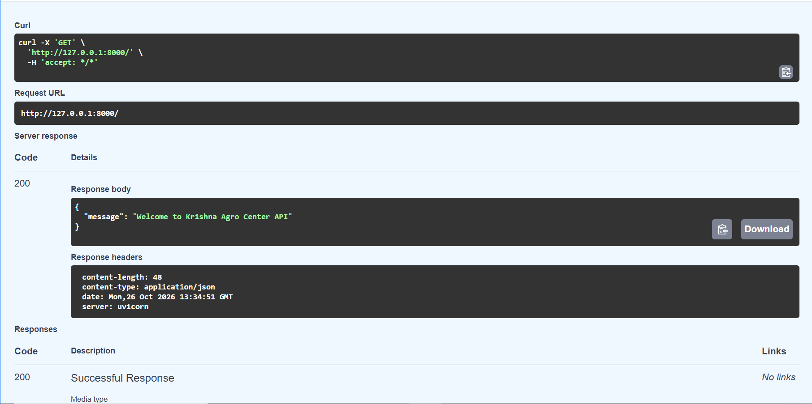
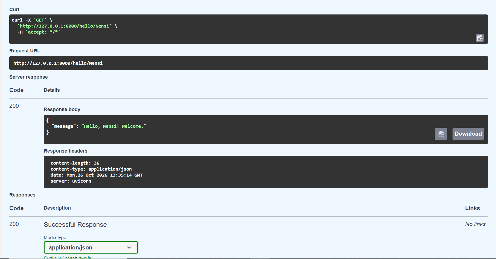
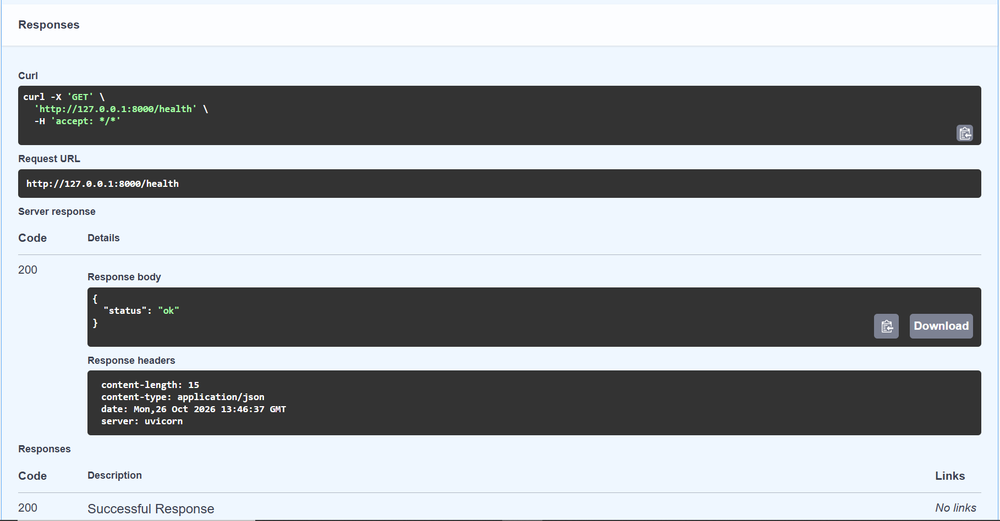
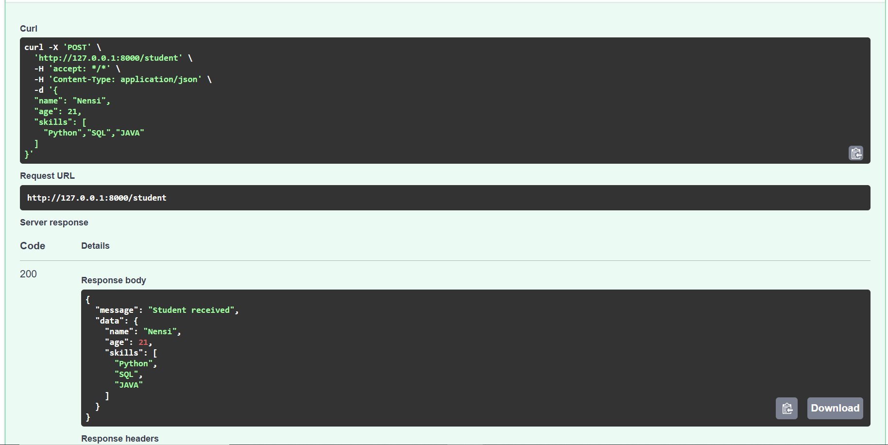

# FastAPI Fundamentals - Task 1

## 1. What I Learned
- **FastAPI:** 
- **API:** 
- **GET vs POST:** 
- **Endpoints:** 
- **Uvicorn:** 
- **Pydantic:** 
- **Swagger UI:** 

## 2. Installation and Running
1. Create a virtual environment: `python -m venv venv`
2. Activate it: `venv\Scripts\Activate.ps1`
3. Install packages: `pip install -r requirements.txt`
4. Run the server: `python -m uvicorn main:app --reload`
5. Open `http://127.0.0.1:8000/docs`

## 3. Endpoints
### GET /
- Purpose:
- Example response:

### GET /hello/{name}
- Purpose:
- Example response:

### GET /health
- Purpose:
- Example response:

### POST /student
- Purpose:
- Example request:
- Example response:

## 4. Screenshots

## 5. Problems and Solutions
- **Problem:** `uvicorn` was not recognized in PowerShell.
  **Solution:** 
- **Problem:** "Try it out" button was missing.
  **Solution:** 

## 6. Short Explanation: GET, POST, Pydantic, Swagger UI